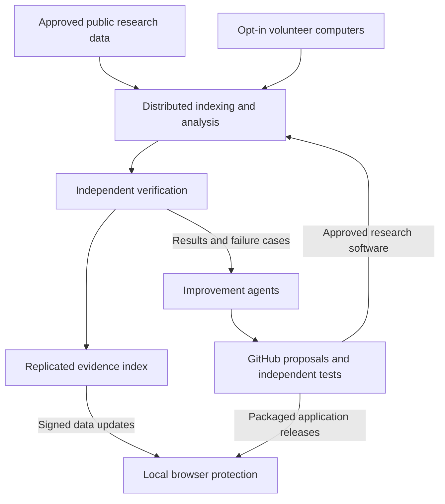

# Daisie Mascara collective defense architecture

Daisie Mascara’s proposed network combines local browser protection with voluntary research compute and a shared evidence index. Its organizing idea is a digital immune system: one independently verified discovery can inform protection across participating devices, while useful evidence and improvements accumulate over time.

## Project status

The repository implements a local Chrome extension with explained phishing warning signs, settings, and a dataset explorer. The volunteer network, replicated index, contribution credits, and recursive improvement system below are proposed architecture. They are not deployed features or measured improvements to detection accuracy. Phishing protection is the first module; the supplied dataset does not establish complete antivirus coverage.

## Core design decisions

| Decision | Reason |
| --- | --- |
| Local protection and a separate opt-in contribution client | People can receive protection without donating compute. Pausing contribution never disables protection. |
| Approved research corpora supply network jobs | Browser activity, private page content, and form values never become volunteer workloads. |
| Predetermined index downloads and local lookups | A remote verdict request, even with a predictable URL hash, can reveal browsing. Downloads must not depend on the current page. |
| Evidence records are separate from access policy | Organizations can require reviewed entries without treating every unknown site as malicious. |
| Verification is separate from contribution and payment | A worker, wallet, or token holder cannot approve its own work merely by participating. |
| Packaged code releases are separate from index data | A refreshed index must not become a way to execute unreviewed code on participants' devices. |

## Two connected loops

The protection loop stays on the user’s device. The research loop processes approved public or synthetic material and distributes verified results back to clients.

## Components

### Browser protection

The browser checks page structure locally and consults a downloaded index snapshot. It presents current findings separately from historical index evidence. A favorable review never suppresses a new suspicious observation. Browsing addresses, page content, form values, and browsing history do not enter volunteer jobs. Protection remains available when contribution is paused or the network is offline.

### Volunteer compute

A separately enrolled client contributes idle CPU or GPU capacity. Participants choose resource budgets and can pause or leave. Work includes feature extraction, classification experiments, index refresh analysis, and independent result checks against approved research material. Initial workers accept bounded, predefined tasks rather than arbitrary remote programs. Completion alone does not earn verified contribution credit.

### Shared index and website

The index stores evidence with explicit URL or domain scope, provenance, review dates, expiry, disagreements, and corrections. It does not turn one suspicious page into an automatic judgment about every page on that domain. The website lets people inspect this evidence, research proposals, contribution verification, and release history.

Reviewed browsing restricts access to entries meeting an organization’s current evidence policy. Open browsing permits unknown or insufficiently reviewed sites with local checks and clear uncertainty. These policies support the proposed safe-browsing and higher-scrutiny modes. Index membership does not guarantee safety, and an absent entry does not establish phishing.

Each record identifies its exact scope: a URL, a page pattern, or an explicitly reviewed host. Preserve conflicting assertions and resolve them using a versioned policy. Useful states are `unknown`, `reviewed`, `phishing evidence`, `disputed`, and `expired`. A favorable old review must expire. Missing or failed checks must never turn into a clean verdict.

The initial client downloads bounded, signed snapshots for its subscribed policies on a fixed schedule. A later design can use predetermined bundles. The browser must not request a shard selected by the currently visited domain. Public index search is a separate, deliberate website action.

### Cryptographic trust and contributions

Signed records identify contributors and make changes detectable. Replicated storage holds evidence and artifacts; a ledger can record their hashes, verification results, and contribution history. Large captures and model files remain outside the ledger. Cryptographic provenance does not establish correctness, and anonymous majority votes do not replace independent verification. Contribution credits reflect checked useful work, not simply generated tokens or reported threats.

LLM tokens are model computation outputs. Blockchain tokens or credits are an accounting mechanism. They have different roles. See [compute, blockchain, and token flow](compute-and-token-flow.md) for the proposed end-to-end mechanism, contract responsibilities, and trust assumptions.

### Independent verification

Evaluators reproduce important results before findings affect the accepted index or a candidate becomes eligible for release. Conflicting evidence remains visible. Clients retain a last verified snapshot and display stale evidence rather than interpreting a failed update as a clean result. Independent operators can publish and mirror signed records under explicit trust policies.

The pilot names its evaluators and release maintainers explicitly. Wallet count does not establish independent control. A participant may contribute useful work without receiving authority to label sites, settle its own rewards, change trust roots, or approve releases. Signed outputs establish attribution; evaluation determines acceptance.

## Recursive improvement and GitHub code evolution

Agents use approved failure cases to propose detector rules, model changes, indexer improvements, and application updates. GitHub pull requests preserve the proposed code and its review history. Independent tests and review precede packaged releases with a rollback path.

The recursive research goal also includes improving how the system chooses experiments, trains candidates, and allocates compute. Compare each proposed process with its predecessor under the same resource budget and an independent benchmark. More tokens or more machines alone do not demonstrate better self-improvement. Candidate agents cannot change their own acceptance rules, hidden evaluation labels, permissions, or release authority.

| Improvement lane | What changes | Acceptance |
| --- | --- | --- |
| Bounded optimization | Approved thresholds, feature subsets, model and training configurations | Automatic selection within a preapproved search space after independent evaluation. |
| GitHub code evolution | Detector, indexer, client, scheduler, or research code | A pull request with isolated tests and independent review, bound to the exact commit and artifact. |
| Improvement of the learning process | Experiment selection, training strategy, or compute allocation | Comparison with the previous process under equal budgets and independently controlled evaluation. |

A candidate binds its parent version, corpus and configuration digests, permitted inputs, resource budget, output artifact, evaluation policy, and results. New commits invalidate an earlier code evaluation. Build releases from the reviewed commit. Record failed experiments as well as successful ones. Changing an evaluator, a permission, or a release key is a separate governance decision.

Browser code improvements ship as packaged extension releases. Index updates contain bounded data rather than executable scripts. Untrusted pull-request code runs without production credentials; signing and publication happen only after the independent gates. This follows the separation required by [Chrome's remotely hosted code policy](https://developer.chrome.com/docs/extensions/develop/migrate/remote-hosted-code) and [GitHub's guidance on untrusted pull-request execution](https://docs.github.com/en/actions/reference/security/securely-using-pull_request_target).

## Failure behavior

| Event | Expected behavior |
| --- | --- |
| Participant pauses or leaves | Stop accepting jobs, cancel work at a bounded checkpoint, and revoke its participation grant when requested. Local browser protection continues. |
| A worker disconnects | Expire and reassign its job lease without paying twice for the same result. |
| Workers submit conflicting results | Mark the result disputed and request independent evaluation. Do not turn a vote count into truth. |
| An index update fails verification or expires | Reject it, expose the stale state, and apply the organization's explicit stale-evidence policy. |
| A code change fails tests or regresses detection | Reject the candidate and retain the current release. |
| An accepted release later causes problems | Distribute an authorized rollback decision and preserve the release history. |

## First demonstration

The build specifications are the [network protocol](network-protocol.md), the [implementation plan](implementation-plan.md), and an [illustrative pilot policy](pilot-policy.example.json). These are design artifacts. The JSON example is not wired into the current extension or a running service; its initial limits require pilot testing.

| Stage | Deliverable | Evidence needed before expanding |
| --- | --- | --- |
| Local demonstration | Three explicitly started workers, a coordinator, versioned index, and contribution credits | Reproducible jobs, a rejected bad result, an accepted candidate, pause/leave behavior, and no browsing uploads. |
| Opt-in pilot | Real contributors, independent evaluators, signed updates, and a public research index | Enforced resource limits, correct retries, independently reproduced gains, and a tested rollback. |
| Federated network | Independent coordinators and index publishers with replicated signed records | Client-selected trust policies, visible conflicts, and continued operation when one operator disappears. |
| Optional token settlement | Settlement of verified work receipts under a disclosed budget | Receipt replay protection, verifier accountability, and economics tested separately from detection quality. |

Evaluate on unseen domain IDs, control duplicate URL IDs, and measure missed phishing, false alerts, local resource use, and compute per verified improvement. Keep a sealed final test outside the improvement agents' context. The anonymized workbook supplies research examples, not an operational blacklist. Future public-corpus ingestion needs its own provenance and collection policy.

The first coordinator is centralized. Additional contributors alone do not change that. Decentralization requires independent operation, replicated artifacts, and a clear way for clients to choose whom they trust.

## Research basis

[Anthropic’s self-replication research](https://www.anthropic.com/research/self-replicating-ai) demonstrates distributed inference and experiments in inheriting useful agent notes. It does not demonstrate this antivirus or its recursive improvement.

[Petals](https://github.com/bigscience-workshop/petals) demonstrates collaborative model inference across participating machines. Its [research paper](https://arxiv.org/abs/2312.08361) informs the optional shared-model compute layer, while live browsing remains local.
