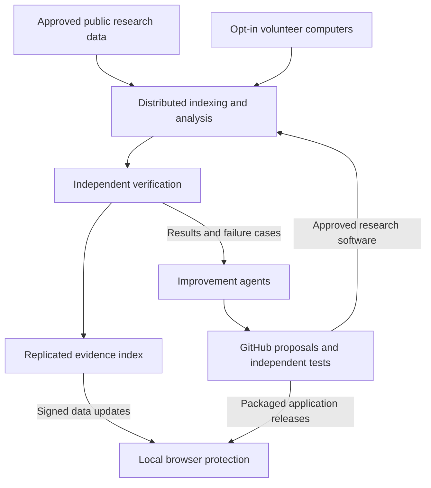

# TideCheck collective defense architecture

TideCheck’s proposed network combines local browser protection with voluntary research compute and a shared evidence index. Its organizing idea is a digital immune system: one independently verified discovery can inform protection across participating devices, while useful evidence and improvements accumulate over time.

## Project status

The repository implements a local Chrome extension with explained phishing warning signs, settings, and a dataset explorer. The volunteer network, replicated index, contribution credits, and recursive improvement system below are proposed architecture. They are not deployed features or measured improvements to detection accuracy. Phishing protection is the first module; the supplied dataset does not establish complete antivirus coverage.

## Two connected loops

The protection loop stays on the user’s device. The research loop processes approved public or synthetic material and distributes verified results back to clients.

## Components

### Browser protection

The browser checks page structure locally and consults a downloaded index snapshot. It presents current findings separately from historical index evidence. A favorable review never suppresses a new suspicious observation. Browsing addresses, page content, form values, and browsing history do not enter volunteer jobs. Protection remains available when contribution is paused or the network is offline.

### Volunteer compute

A separately enrolled client contributes idle CPU or GPU capacity. Participants choose resource budgets and can pause or leave. Work includes feature extraction, classification experiments, index refresh analysis, and independent result checks against approved research material. Initial workers accept bounded, predefined tasks rather than arbitrary remote programs. Completion alone does not earn verified contribution credit.

### Shared index and website

The index stores evidence with explicit URL or domain scope, provenance, review dates, expiry, disagreements, and corrections. It does not turn one suspicious page into an automatic judgment about every page on that domain. The website lets people inspect this evidence, research proposals, contribution verification, and release history.

Reviewed browsing restricts access to entries meeting an organization’s current evidence policy. Open browsing permits unknown or insufficiently reviewed sites with local checks and clear uncertainty. These policies support the proposed safe-browsing and higher-scrutiny modes. Index membership does not guarantee safety, and an absent entry does not establish phishing.

### Cryptographic trust and contributions

Signed records identify contributors and make changes detectable. Replicated storage holds evidence and artifacts; a ledger can record their hashes, verification results, and contribution history. Large captures and model files remain outside the ledger. Cryptographic provenance does not establish correctness, and anonymous majority votes do not replace independent verification. Contribution credits reflect checked useful work, not simply generated tokens or reported threats.

### Independent verification

Evaluators reproduce important results before findings affect the accepted index or a candidate becomes eligible for release. Conflicting evidence remains visible. Clients retain a last verified snapshot and display stale evidence rather than interpreting a failed update as a clean result. Independent operators can publish and mirror signed records under explicit trust policies.

## Recursive improvement and GitHub code evolution

Agents use approved failure cases to propose detector rules, model changes, indexer improvements, and application updates. GitHub pull requests preserve the proposed code and its review history. Independent tests and review precede packaged releases with a rollback path.

The recursive research goal also includes improving how the system chooses experiments, trains candidates, and allocates compute. Compare each proposed process with its predecessor under the same resource budget and an independent benchmark. More tokens or more machines alone do not demonstrate better self-improvement. Candidate agents cannot change their own acceptance rules, hidden evaluation labels, permissions, or release authority.

## First demonstration

Start with three explicitly enrolled local workers, one research coordinator, and a versioned index. Demonstrate both an accepted improvement and a rejected regression. Evaluate on unseen domain IDs, control duplicate URLs, and measure missed phishing, false alerts, and compute per verified result. Describe the initial coordinator as centralized; replication and independent operators are later decentralization work.

## Research basis

[Anthropic’s self-replication research](https://www.anthropic.com/research/self-replicating-ai) demonstrates distributed inference and experiments in inheriting useful agent notes. It does not demonstrate this antivirus or its recursive improvement.

[Petals](https://github.com/bigscience-workshop/petals) demonstrates collaborative model inference across participating machines. Its [research paper](https://arxiv.org/abs/2312.08361) informs the optional shared-model compute layer, while live browsing remains local.
