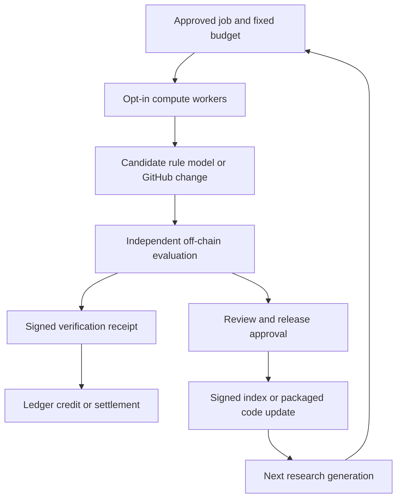

# Compute blockchain and token flow

This is a proposed design for Daisie Mascara's collective research network. No blockchain, transferable token, or autonomous improvement service is deployed in the current extension.

## Two meanings of token

| Term | Meaning in this system |
| --- | --- |
| LLM token | A unit of model input or generated output processed using contributed compute. |
| Blockchain token or contribution credit | An accounting unit awarded or transferred under an explicit policy for accepted work. |

The models generate research outputs. The chain records commitments and settlement. Minting a token does not train a model, create computing capacity, or establish that an experiment improved protection.

## End-to-end flow

1. Publish a job with a parent version, approved corpus and configuration digests, accepted task type, deadline, verification policy, and fixed reward budget.
2. Consenting workers accept bounded assignments. Stronger machines can run a complete model; compatible participants can later host model shards. Smaller machines can run independent feature, evaluation, or research jobs.
3. A worker submits an artifact and signed work receipt. Completion and self-reported token counts are unverified claims at this point.
4. Independently controlled evaluators reproduce critical results and test the candidate. A failed improvement can still earn evaluation credit if the assigned evaluation itself was completed correctly.
5. Accepted work receives a verification receipt tied to the exact job, artifact, and evaluation-policy version. A ledger records credits or settles payment only once after the configured dispute period.
6. A separate release decision approves the candidate for distribution. Receiving a reward does not authorize deployment.
7. The accepted detector and experiment history inform the next generation. Changes to the research process receive equal-budget comparisons against their predecessors.

## What runs where

| Off-chain | On-chain if blockchain settlement is adopted |
| --- | --- |
| Indexing, feature extraction, LLM inference, training, testing, review, and website search | Job commitments, budget rules, accepted receipt references, settlement records, and approved release checkpoints |
| Large datasets, model weights, source code, detailed public research artifacts | Digests and references to approved artifacts |
| Independent evaluation of claims | Checks that authorized evaluators signed a correctly formed receipt |

The minimal contract responsibilities are a job registry, an evaluator-policy registry, replay-protected settlement, and release checkpoints. These can be modules of one audited design rather than separate contracts. Settlement must handle failed, cancelled, expired, and disputed jobs explicitly.

## Trust and incentives

A hash binds a receipt to an artifact; it does not establish that the artifact is correct. Smart contracts need off-chain information to act on off-chain results, the problem described in [Ethereum's oracle documentation](https://ethereum.org/developers/docs/oracles/). The evaluator policy remains a real trust assumption and must name independent control, not count wallets as independent people.

Reward verified useful work under a predefined budget. Do not reward the number of sites accused of phishing or unverified generated tokens. A successful comparison can accept or reject a candidate; either outcome is useful when the evaluation is correct. Contribution credits have no promised monetary value. A future transferable token is a separate funding and governance decision, not a requirement for distributed inference.

Live browsing URLs, their predictable hashes, private prompts, and personal data never enter the chain or volunteer jobs. The browser consults downloaded index data locally. Models in a public swarm may expose their inputs to participating hosts, so shared work uses approved public or synthetic material.

## Relation to recursive improvement

Distributed inference increases research capacity. The blockchain coordinates attribution and settlement. Recursive improvement is the independently measured effect of accepted changes to the detector or to the process that creates later improvements. These three outcomes must be reported separately.

[Petals](https://github.com/bigscience-workshop/petals) demonstrates collaborative model inference across participating machines. [Hivemind](https://learning-at-home.readthedocs.io/en/latest/) provides decentralized learning components. Neither supplies this project's complete verification, reward, or release-governance system.
