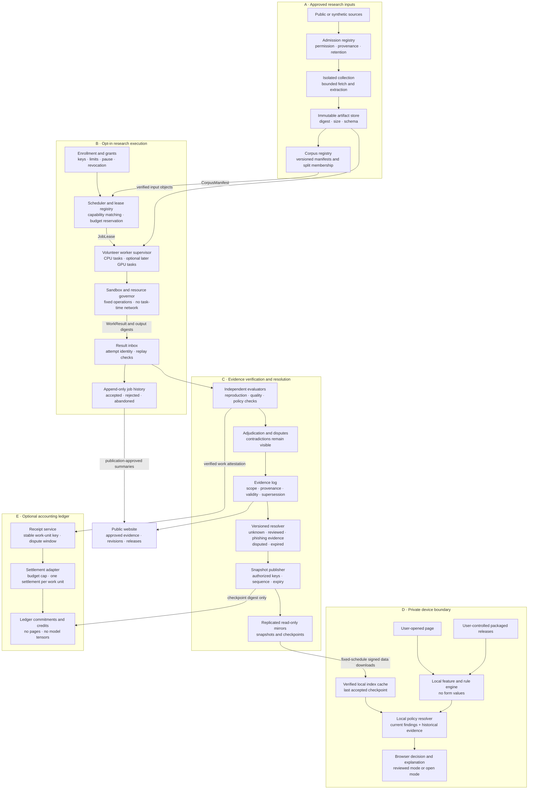

# Daisie Mascara: detailed system architecture

**Design status:** the local Chrome extension exists. The distributed research network, replicated index, contribution ledger, and recursive improvement services described here are a proposed system. This document explains the target design and its trust boundaries; it does not claim the network has been built or its detection benefits measured.

The system has two separate paths. A private browser path inspects the current page locally. A voluntary research path learns from approved public or synthetic material, then publishes reviewed evidence and packaged software. The browser never contributes its history, live page contents, form values, or a page-selected lookup request to that research path.

## 1. System map: from research material to local protection

The arrows name the objects crossing boundaries. Storage holds immutable, content-addressed objects; publishers sign the versions clients are allowed to consume. “Independent” means separately controlled evaluation authority, not many wallets controlled by the same contributor.

**Read the map:** useful compute enters through a bounded lease; evidence enters the index only through evaluation and resolution. Browser decisions are local. The ledger records accepted commitments and accounting; it has no arrow that can declare a site safe, authorize a release, or read a user's page.

The detailed [component contracts](architecture-components.md) define ownership and failure behavior. The [workflow diagrams](architecture-workflows.md) show request ordering. The [v1 network protocol](network-protocol.md) defines the six signed record types and the initial two permitted operations.

## 2. What crosses each trust boundary

| Boundary | Permitted object | Check before crossing | Failure behavior |
| --- | --- | --- | --- |
| Source → research corpus | Approved material and provenance manifest | Permission, purpose, size, content type, extraction limits and split assignment | Quarantine; no automatic public redistribution |
| Coordinator → worker | `JobLease` plus referenced `CorpusManifest` | Grant, operation allowlist, input digests, remaining budget, nonce and deadline | Reject assignment; local pause always wins |
| Worker → evaluators | `WorkResult` and immutable output objects | Schema, input binding, attempt identity, limits and signature | Reject malformed submissions; retain audit status |
| Evaluators → evidence log | Attested `EvidenceRecord` | Separately controlled authority, reproducibility, exact subject scope and validity | Dispute or reject; retain contradictory observations |
| Publisher → browser | `IndexCheckpoint` and data snapshot | Authorized keys, sequence, digest, expiry and supported schema | Keep last verified cache and expose staleness |
| Research → code release | Candidate commit, test artifacts and approval record | Independent evaluation and review of that exact commit | Keep current version; changes invalidate prior approval |
| Receipt service → ledger | Accepted work digest and stable settlement key | Budget authorization, dispute period, uniqueness and verifier policy | Pending or rejected credit; protection remains available |

An artifact digest proves which bytes were used. A signature proves who made an authorized statement. Neither proves the scientific result, source label, or website itself is correct. That is why provenance, independent checks, disagreement handling, and local observations remain separate components.

## 3. Recursive improvement is a versioned experiment loop

The target has three improvement lanes: bounded model/configuration search; reviewed code changes; and changes to the learning process itself. The diagram shows the code-change lane; an approved bounded configuration can follow an artifact approval path without a source-code pull request. V1 runs fixed research operations. More flexible experiment planners, model training, and distributed inference are later capabilities with separate grants and evaluation.

```mermaid
flowchart LR
    ERR["Approved failures and drift reports"] --> PICK["Experiment planner<br/>hypothesis · parent version · budget"]
    PICK --> PROPOSE["Proposal agent<br/>rules · model config · code patch<br/>or experiment-selection policy"]
    PROPOSE --> RUN["Isolated research runner<br/>pinned corpus and dependencies"]
    RUN --> COMPARE["Independent comparison<br/>same budget · domain-held-out data"]
    COMPARE -->|fails or uncertain| HISTORY["Experiment registry<br/>negative results retained"]
    COMPARE -->|passes declared gates| PR["GitHub pull request<br/>exact commit and artifact digests"]
    PR --> CI["Unprivileged CI<br/>tests · resource and privacy checks"]
    CI --> REVIEW["Independent maintainer review<br/>no candidate release authority"]
    REVIEW --> SIGN["Release signing<br/>versioned package and manifest"]
    SIGN --> CANARY["Bounded rollout<br/>measure regressions and cost"]
    CANARY -->|accepted results| PARENT["New approved parent version"]
    PARENT --> PICK
    CANARY -->|regression| ROLLBACK["Authorized rollback<br/>prior package plus incident record"]
    HISTORY --> PICK
```

Each experiment binds a parent version, hypothesis, allowed change space, dataset split, resource budget, candidate digest, metrics, and evaluation-policy version. Code-generation agents cannot modify hidden labels, their acceptance criteria, enrollment permissions, evaluator keys, or release keys. A new commit requires a new evaluation. A release is built from the reviewed commit, never from a moving branch name.

For **recursive** improvement, evaluate a new experiment-selection or training process against its previous version under equal total budgets. Compare the quality and cost of the improvements it produces, including failed attempts. More machines, more generated text, or a larger token count alone demonstrate increased expenditure, not improved learning. Keep a sealed final test outside the planner's context; repeated evaluation against the same hidden test can itself leak information, so use access limits and an independent final decision.

The pilot gates should include missed phishing, false alerts, calibration where probabilities are claimed, latency, memory, energy proxies, and compute per accepted improvement. Report per-domain and temporal generalization where the corpus supports them. The current anonymized workbook has no reliable live URL mapping and does not support every temporal claim.

## 4. How shared computation and crypto fit

**LLM tokens** are model input and generated output. In the proposed v1, enrolled idle devices would supply bounded feature processing and evaluation; later, compatible GPU peers could host model layers for shared inference over public research prompts. That requires model compatibility, capacity scheduling, activation transport, retry handling, and separate privacy assessment. It is not supplied by a blockchain.

**Contribution credits or blockchain tokens** account for verified useful work. Reserve a job budget, check the result, wait for its dispute period, then settle at most once using `networkId + jobId + workUnitId`. Retries do not mint extra payable work. Reward successful execution of a useful evaluation even if it disproves a proposed improvement. Do not reward threat count, raw token output, anonymous agreement, or fabricated CPU time.

Bulk corpora, outputs, snapshots, and models remain in replicated off-chain storage. An optional ledger contains commitments, authorized verification receipts, budget reservations, settlements, and checkpoint anchors. Smart contracts can enforce the accounting rules they receive; their dependence on off-chain attestations remains explicit. The first demonstration uses nonmonetary credits. Chain selection, public token issuance, economic incentives, and proof-of-useful-work remain separate design and validation decisions.

## 5. Operational control and decentralization

- **Participant control:** the worker supervisor owns local limits, idle detection, battery policy, pause and removal. A server cannot expand a grant. Receiving protection does not require contributing compute.
- **Trust control:** clients choose a publisher namespace and trust policy. Contributor identity, evaluator authority, index publishing, settlement approval, and software release are separate roles.
- **Failure containment:** output quarantine separates untrusted computation from accepted evidence. A faulty model candidate cannot rewrite the index or install itself. An unavailable ledger does not stop local scans or invalidate already verified evidence.
- **Revocation and recovery:** revoke compromised keys, publish a signed replacement policy, retain verifiable history, and use separately authorized recovery/rollback paths. Exact quorum and key-rotation rules must be fixed before an external pilot.
- **Actual decentralization:** multiple independently operated coordinators, artifact mirrors, evaluators and publishers can exchange signed records. Namespaces preserve disagreements. Federation does not require all operators to accept one global verdict or token-weighted vote.

A single coordinator with many volunteer workers is distributed compute, but still centralized coordination. The [implementation plan](implementation-plan.md) makes that the honest first milestone, then adds independent operation only after correctness and failure recovery are demonstrated.

## 6. Why the dataset leads to this design

The analysis contains **4,554 domain IDs with multiple distinct phishing URLs**, which motivates testing evidence reuse. **43 domain IDs contain both phishing and legitimate labels**, which motivates scope-aware, time-bounded evidence and a local final check. These are anonymized domain identities; they do not establish attacker identities or an operational blacklist. The observed **92,300 phishing / 123,495 legitimate records** describe this dataset, not web-wide prevalence. See [domain analysis](domain-analysis.md) and [data findings](data-findings.md).

## Design sources and limits

[Anthropic's research](https://www.anthropic.com/research/self-replicating-ai) motivates distributed inference and inherited research memory; it does not validate this antivirus. [Petals](https://github.com/bigscience-workshop/petals) and its [paper](https://arxiv.org/abs/2312.08361) provide a reference for cooperative model execution. [Ethereum's oracle documentation](https://ethereum.org/developers/docs/oracles/) explains the dependence on off-chain truth. [The Update Framework](https://theupdateframework.github.io/specification/latest/) informs separated signing roles and update metadata; this design is not claiming TUF compliance. Browser software must remain compatible with [Chrome's packaged-code requirements](https://developer.chrome.com/docs/extensions/develop/migrate/remote-hosted-code), and candidate CI must respect [GitHub's untrusted pull-request boundaries](https://docs.github.com/en/actions/reference/security/securely-using-pull_request_target).
