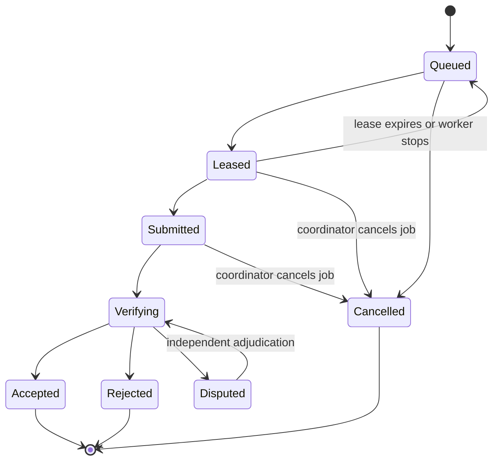

# Daisie Mascara network protocol

This is the proposed v1 contract for the [collective defense architecture](architecture.md). It is not implemented in the current extension. V1 uses one coordinator and a signed index. Multiple processes on one demonstration computer simulate roles; they do not establish independent verification or decentralization.

The browser protection path and volunteer research path remain separate. Browsers receive predetermined index updates and decide locally. Enrolled workers process approved research artifacts. The [compute and token flow](compute-and-token-flow.md) describes how accepted work can receive credit without granting release authority. [The example pilot policy](pilot-policy.example.json) records initial limits to validate; it is not active runtime configuration.

## Signed records

Every durable record carries a record type, schema version, issuer key identifier, issue time, expiry where applicable, and typed payload. Signatures cover a deterministic representation of those fields with a protocol and record-type context. Record identifiers are hashes of the signed content, excluding the signature list. The exact serialization and cryptographic profile must be fixed before interoperable clients ship.

Receivers verify the schema, sizes, signature, issuer authority, expiry, and referenced objects. A valid signature identifies an authorized statement; it does not prove the statement true. Unknown record versions or executable fields are rejected. Times use UTC; durations and resource quantities have explicit units.

## Six core objects

| Object | Required payload | Meaning |
| --- | --- | --- |
| `NodeGrant` | Node public key, project, allowed task types, CPU/GPU and memory limits, bandwidth allowance, allowed hours, idle/battery policy, expiry, revocation reference | Records deliberate enrollment and the participant's maximum contribution. Local pause or leave overrides a remote assignment. It grants no access to browser profiles or personal files. |
| `CorpusManifest` | Artifact digests and sizes, provenance, sharing permission, public/synthetic classification, feature schema, extractor version, permitted uses, training/development split references | Defines the research inputs. A manifest must not expose sealed evaluation labels. Possession of the datathon workbook does not itself authorize redistribution. |
| `JobLease` | Network, job, work-unit and attempt identifiers, leased node, nonce, task type, input/configuration/model digests, output schema, deadline, maximum runtime, resource limits, verification-policy reference | Assigns one bounded attempt. It permits only artifacts and operations covered by the task and the node's grant. |
| `WorkResult` | Network, job, work-unit, attempt and nonce, input digests, output digest, worker software version, declared measurements, submission time, node signature | Submits a result for verification. Resource and token totals remain claims until checked. Evaluator attestations bind the accepted result and evaluation version. |
| `EvidenceRecord` | Subject, exact scope, observation, supporting artifact digests, method/version, provenance, observation time, validity interval, evaluator attestations, dispute or supersession references | Makes a time-bounded assertion about an approved research subject. It does not create permanent trust or automatically classify every page under a host. |
| `IndexCheckpoint` | Publisher namespace, monotonic sequence, previous checkpoint digest, snapshot digest and size, resolver-policy version, expiry, authorized signatures | Identifies an accepted index version. Clients verify its continuity and artifacts before making it available for local lookup. It contains data references, not executable browser updates. |

V1 jobs use only two fixed built-in operations: `summarize_features_v1` and `evaluate_detector_v1`. Inputs are downloaded and verified before execution; task execution has no network access. Candidate generation initially remains an operator-defined process outside volunteer workers; generated proposals are data to inspect. A job cannot supply a shell command, JavaScript program, plugin, unrestricted download address, or a change to its execution permissions. Candidate search and larger-model inference require later explicitly approved task types. Grant changes may narrow or revoke existing permission immediately; expanding permission requires renewed explicit enrollment.

## Jobs, attempts, and credit

The coordinator owns a job's authoritative state. Each lease has a separate attempt identity so an interrupted attempt can be retried without rewriting history.

Worker stop cancels its attempt, not necessarily the whole job. A coordinator may requeue that job with a new lease and nonce. A late completion cannot complete a replacement attempt. A terminal cancelled job requires a new job identifier if the research is resumed. Rejection is final for that result; a corrected proposal is a new job.

Verification checks the assigned operation, exact inputs, output shape, reproducibility, and applicable evaluation policy. A malformed result is rejected. Conflicting valid-looking results enter dispute and receive separate adjudication; worker-majority voting is insufficient. The coordinator also records abandoned attempts and failed experiments.

Acceptance of a work result is separate from acceptance of a detector improvement. Correctly demonstrating that a candidate fails can satisfy an evaluation job. Credit becomes eligible only after verification and the configured dispute period. Settlement is idempotent on `networkId + jobId + workUnitId`, never on the lease or attempt identifier. A retry cannot create another payable work unit. Accepted receipt identifiers link the evidence to that stable settlement key. A paid receipt never authorizes a software release.

## Evidence resolution and index delivery

V1 supports `exact_url` and `host` subjects. Each uses a versioned normalization rule. An exact-URL observation must not expand into host-wide evidence automatically. Pattern and registered-domain subjects require a later defined matching policy. The anonymized dataset's IDs are research grouping keys, not operational website addresses.

The resolver derives `unknown`, `reviewed`, `phishing_evidence`, `disputed`, or `expired` from accepted records and their validity intervals. Missing evidence remains unknown. A favorable review cannot suppress a fresh local concern. Contradictions remain inspectable rather than disappearing into one average score.

Clients download complete snapshots or predetermined subscription bundles on a schedule unrelated to browsing. They reject wrong digests, unauthorized signers, broken sequence continuity, and expired metadata. A failed update leaves the last verified snapshot available with its age and applicable stale-evidence policy. Rollback requires an authorized rollback decision, not arbitrary acceptance of an older sequence.

## Minimal service boundaries

| Operation | Caller and behavior |
| --- | --- |
| `POST /v1/nodes/enroll` | Worker submits explicit enrollment and requests a bounded grant. |
| `POST /v1/nodes/{id}/revoke` | Authorized participant revokes future work; local stop is immediate and does not depend on this request. |
| `POST /v1/jobs/leases` | Worker requests an assignment compatible with its grant and current limits. |
| `POST /v1/jobs/{id}/results` | Worker submits one attempt result using its nonce and artifact references. |
| `GET /v1/results/{id}` | Authorized caller reads verification, dispute, and credit status. |
| `GET /v1/index/{namespace}/latest` | Client receives signed checkpoint metadata on its update schedule. |
| `GET /v1/objects/{digest}` | Client retrieves a size-bounded artifact referenced by an authorized manifest. |

There is no browser `/verdict?url=...` or URL-hash lookup endpoint. Predictable hashes and browsing-selected shard requests can disclose visited sites. Authentication, request limits, replay checks, and schema limits apply at every write boundary. Public read access is restricted to artifacts approved for publication; sealed tests and private evaluation records remain outside the public index.

## Acceptance invariants

- No remote job increases a participant's grant or defeats local pause.
- No worker submission alone changes accepted index state, release state, or settled credit.
- Every accepted artifact remains traceable to exact inputs, evaluation policy, and signers.
- Pausing contribution, losing the network, or rejecting an update does not disable local scanning.
- Browsing records never enter research jobs, public artifacts, or settlement metadata.
- Tests, review, and the client's trusted release policy remain separate from the candidate's authority.
