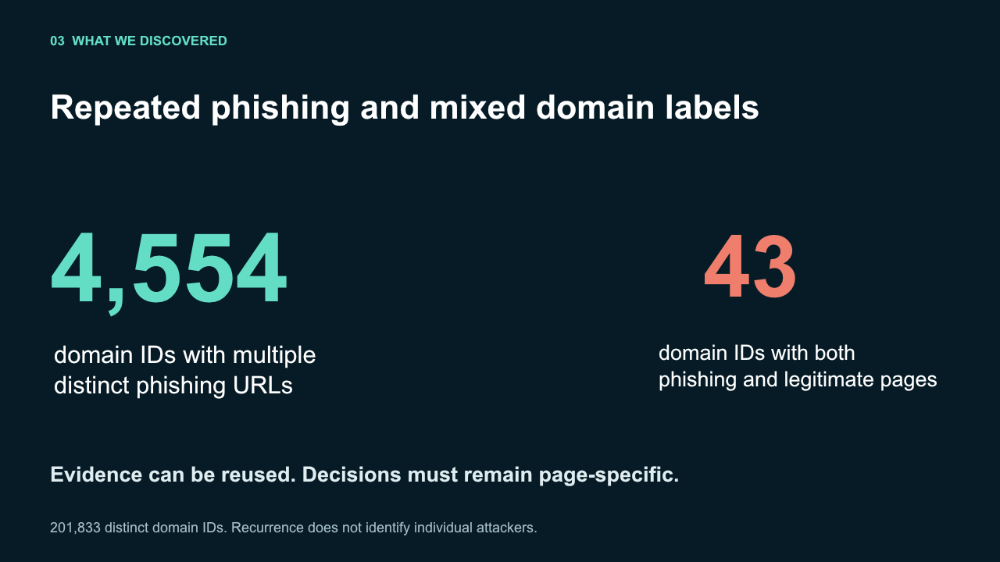
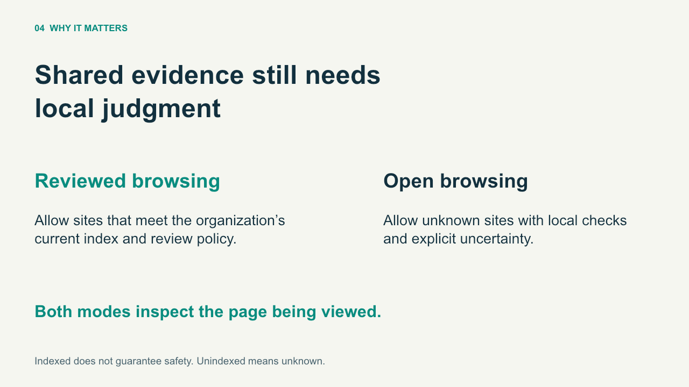
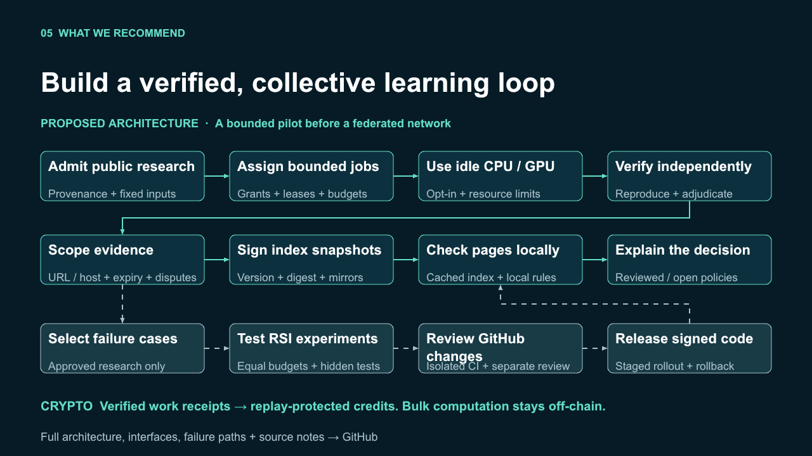

# Daisie Mascara presentation

[Download the five-slide PowerPoint](daisie-mascara-digital-immune-system.pptx)

The deck follows the assignment structure: the problem, the approach, findings, implications, and recommendations. Speaker notes include evidence sources and distinguish the current browser extension from the proposed volunteer compute network, shared index, and recursive improvement process.

Slide 5 maps the new architecture: source admission, leased volunteer jobs, independent verification, scoped evidence, signed snapshots, local browser decisions, verified-work credits, and the GitHub recursive improvement loop. Its speaker notes expand the mechanisms and link the full [architecture document](../docs/detailed-architecture.md), [component contracts](../docs/architecture-components.md), and [workflow diagrams](../docs/architecture-workflows.md).

The presentation uses a conceptual immune-system illustration. The chart, architecture diagram, text, and speaker notes remain editable in the PowerPoint file. The deck contains exactly five slides.

## Preview

