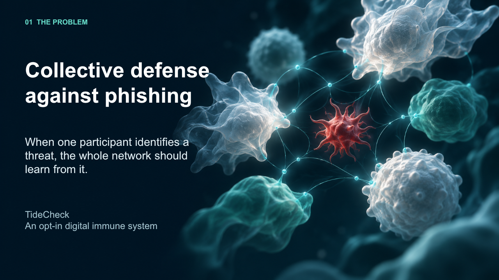
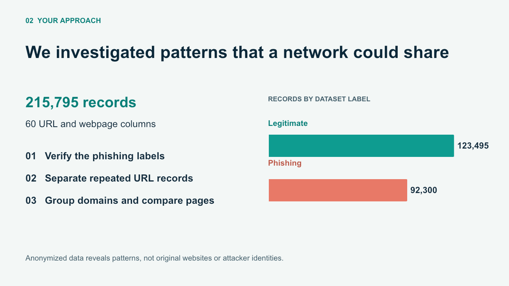

# TideCheck presentation

[Download the five-slide PowerPoint](tidecheck-digital-immune-system.pptx)

The deck follows the assignment structure: the problem, the approach, findings, implications, and recommendations. Speaker notes include evidence sources and distinguish the current browser extension from the proposed volunteer compute network, shared index, and recursive improvement process.

The presentation uses a conceptual immune-system illustration. The editable charts, tables, text, and speaker notes remain in the PowerPoint file.

## Preview

